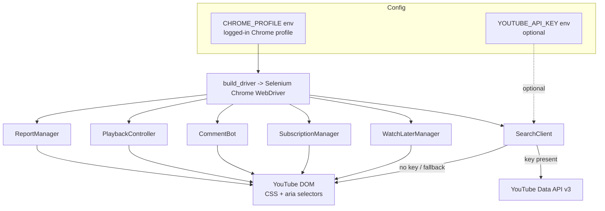

# YouTube Content Automation

**A Python library to automate YouTube actions — watch-later, subscriptions, comments, playback, reporting, and search — via Selenium element/selector automation plus the YouTube Data API v3.**

Element/selector-driven. No pixel coordinates. No image matching.

[](https://github.com/chirag127/youtube-content-automation/stargazers)
[](LICENSE)
[](https://github.com/chirag127/youtube-content-automation/commits)
[](https://python.org)
[](https://www.selenium.dev/)

## What it is / why it exists

Bulk YouTube housekeeping — queueing dozens of videos to Watch Later, cleaning up subscriptions, batch-commenting, or watching through a playlist hands-free — is tedious in the UI and only partly covered by the official API. This library wraps both worlds behind small, composable manager classes: a driver reads your real logged-in Chrome profile, actions are driven by stable CSS/aria selectors (not brittle screen coordinates), and search can go through the Data API v3 when a key is present or fall back to Selenium scraping when it isn't.

## Links

- **Repo:** https://github.com/chirag127/youtube-content-automation
- **GitHub Pages:** this is a library, not a website — GitHub Pages (https://chirag127.github.io/youtube-content-automation/) serves the repo landing/about page only.

## ⭐ Star this repo

If this is useful, please ⭐ star the repo — it helps others find it.

## Architecture



## Features

| Class | Actions |
|---|---|
| `WatchLaterManager` | Add search results / history / all-results to Watch Later |
| `SubscriptionManager` | List subscriptions, unsubscribe-all |
| `CommentBot` | Post comments on videos (from a list or a file) |
| `PlaybackController` | Watch-all playlist, skip-on-dislike, auto-advance |
| `ReportManager` | Report videos for spam / content violations |
| `SearchClient` | Search via Data API v3 (with key) or Selenium fallback |
| `TelegramGroupManager` | Leave Telegram groups via Telegram Web (unrelated to YouTube; separate module) |

All manager classes extend a shared `BaseAutomation`; selectors and aria-labels are named constants at the top of each module, so a YouTube DOM change is a one-line fix.

## Tech stack

| Layer | Technology |
|---|---|
| Language | Python 3.10+ |
| Browser automation | `selenium` >= 4.20 (Chrome WebDriver) |
| Official API | `google-api-python-client` >= 2.130 (YouTube Data API v3) |
| Packaging | setuptools (`pyproject.toml`, `pip install -e .`) |
| Tests | `pytest` + `pytest-mock` (WebDriver mocked — no real browser needed) |

## Repository structure

```
youtube-content-automation/
├── src/yt_automation/
│   ├── __init__.py         # public exports: managers + build_driver, wait
│   ├── base.py             # BaseAutomation — shared driver helpers
│   ├── driver.py           # build_driver() Chrome WebDriver factory + wait()
│   ├── watch_later.py      # WatchLaterManager
│   ├── subscriptions.py    # SubscriptionManager
│   ├── comments.py         # CommentBot
│   ├── playback.py         # PlaybackController
│   ├── reporting.py        # ReportManager
│   ├── search.py           # SearchClient (Data API v3 + Selenium fallback)
│   └── telegram_extra.py   # TelegramGroupManager (separate, non-YouTube)
├── examples/               # runnable example scripts per manager
├── tests/                  # pytest suite (WebDriver mocked)
├── pyproject.toml
└── requirements.txt
```

## Quick start

```bash
pip install -e .
# or just install deps
pip install -r requirements.txt
```

Requires Python 3.10+, Google Chrome, and [ChromeDriver](https://chromedriver.chromium.org/) on PATH.

### Login setup

All YouTube automation runs against a logged-in Chrome session. `build_driver()` reads your real Chrome profile — no passwords or cookies are stored in the code.

```bash
# Windows
set CHROME_PROFILE=C:\Users\YourName\AppData\Local\Google\Chrome\User Data\Profile 1

# Linux / macOS
export CHROME_PROFILE=~/.config/google-chrome/Profile\ 1
```

Optionally set a Data API v3 key for API-powered search:

```bash
export YOUTUBE_API_KEY=your_data_api_v3_key
```

## Configuration

Configuration is via environment variables (names + purpose only):

| Variable | Purpose |
|---|---|
| `CHROME_PROFILE` | Path to a Chrome user-data-dir already logged into YouTube; the WebDriver reuses its session. Optional — falls back to a temp profile. |
| `YOUTUBE_API_KEY` | YouTube Data API v3 key. When set, `SearchClient` uses the official API; otherwise it falls back to Selenium scraping. Optional. |

`build_driver()` also accepts `headless=`, `profile_dir=`, and `window_size=` arguments to override the defaults per call.

## Usage

```python
from yt_automation import WatchLaterManager, build_driver

driver = build_driver()                        # reads CHROME_PROFILE
mgr = WatchLaterManager(driver)
mgr.from_search("Python tutorial", max_videos=20)
mgr.from_history(max_videos=10)
mgr.from_all_results("data structures", scroll_rounds=5, max_videos=50)
driver.quit()
```

```python
from yt_automation import SubscriptionManager, build_driver

driver = build_driver()
mgr = SubscriptionManager(driver)
print(mgr.list_subscriptions())
mgr.unsubscribe_all(max_channels=100)
driver.quit()
```

```python
from yt_automation import CommentBot, build_driver

driver = build_driver()
bot = CommentBot(driver)
bot.comment_on_video("https://youtube.com/watch?v=XYZ", "Great video!")
bot.comment_from_file("urls.txt", "Thanks for sharing!")
driver.quit()
```

```python
from yt_automation import SearchClient, build_driver

driver = build_driver(headless=True)
client = SearchClient(driver)                  # Data API v3 if YOUTUBE_API_KEY set, else Selenium
for r in client.search("Selenium tutorial", max_results=10):
    print(r["title"], r["url"])
driver.quit()
```

```python
from yt_automation import ReportManager, build_driver
from yt_automation.reporting import REPORT_SPAM_TEXT

driver = build_driver()
ReportManager(driver).report_video("https://youtube.com/watch?v=XYZ", reason=REPORT_SPAM_TEXT)
driver.quit()
```

```python
from yt_automation import PlaybackController, build_driver

driver = build_driver()
PlaybackController(driver).watch_all_in_watch_later(seconds_per_video=60, max_videos=20)
driver.quit()
```

More runnable scripts live in [`examples/`](examples/).

## Run tests

```bash
pip install -e ".[dev]"   # or: pip install pytest pytest-mock
pytest
```

Tests mock the WebDriver — no real browser required.

## Selector maintenance

All CSS selectors and aria-labels are defined as named constants at the top of each module (e.g. `SEL_SEARCH_BOX`, `SEL_VIDEO_TITLE`). When YouTube's DOM changes, update the constant in one place.

## Part of the oriz family

This library is one of ~80 sites and tools in the **oriz** family. See the rest at [blog.oriz.in](https://blog.oriz.in).

## Disclaimer

Automating YouTube may violate [YouTube's Terms of Service](https://www.youtube.com/t/terms). This library is intended for **personal and educational use only**. Use responsibly.

## Contributing

Issues and PRs welcome. Run `pytest` before submitting. Conventional commits are the changelog.

## License

MIT © Chirag Singhal — see [LICENSE](LICENSE).

## Author

**Chirag Singhal** — [chirag@oriz.in](mailto:chirag@oriz.in)

## Status & roadmap

Working library, v0.1.0. Future ideas: Firefox driver support, a thin CLI wrapper, and richer Data API v3 coverage (playlists, channel management).
